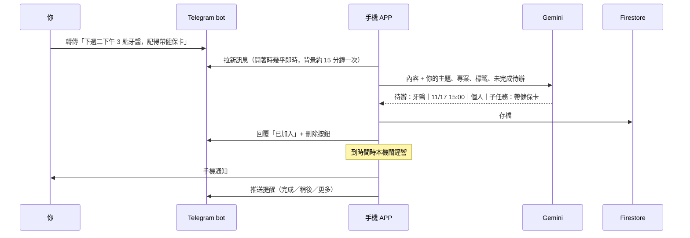

# 生活管理 APP（自建版）

這是一個給自己用的 Android 生活管理與待辦 APP。用打字、說話、從其他 APP 分享，或傳訊息給自己的 Telegram bot，都能交給 AI 整理成待辦。AI 會自動分主題、拆子任務、建議專案、抓時間，接著準時提醒你，每週再給你一份統計總覽。

**全部用你自己的帳號，而且都是免費方案**：你自己的 Firebase（雲端同步）、你自己的 Gemini API key（AI 整理），以及你自己的 Telegram bot。作者看不到你的任何資料。

👉 **要開始安裝，請看 [SETUP.md](SETUP.md)**，照著做大約 30–45 分鐘，不需要寫程式，也不需要裝 Android Studio。

---

## 功能特點

| 功能 | 說明 |
|---|---|
| 快速輸入 | 打字，或用手機本機的語音轉文字（不耗 AI 額度） |
| 分享進 APP | 在 LINE、瀏覽器、相簿等任何 APP 按「分享 → 加入待辦」，文字、截圖、語音、PDF、聊天紀錄 .txt 都可以 |
| Telegram 收件匣 | 傳文字、轉傳訊息、語音或截圖給自己的 bot，AI 整理好就直接建立待辦，每一筆都附刪除按鈕 |
| 雙向提醒 | 手機會跳通知，同時推到 Telegram，附「完成／稍後／更多」按鈕。在公司或家裡的電腦開 Telegram 也收得到 |
| 專案管理 | 專案、子任務、狀態（待辦／進行中／等待／完成／取消）、專案看板 |
| 主題與標籤 | 預設主題為工作、家庭、個人、知識。AI 會自動貼標籤，之後都能改 |
| 重複提醒 | 每天、每週、每月等 |
| 每週統計 | 完成率、逾期、各主題分布 |
| Google 帳號同步 | 換手機或重灌 APP 後，資料都還在 |

## AI 整理：支援什麼、整理成什麼

**可以丟進來的內容**：APP 內打字或說話、Android 分享、Telegram（文字、轉傳的 LINE／TG 訊息、語音訊息由 AI 直接聽、截圖或照片由 AI 直接看）。

**AI 會整理成這樣**：
- **一則拆多筆**：一段訊息裡有好幾件事會各列一筆。別人說「已經幫你約好下週二下午」這種事也會列出來。
- **子任務加上建議專案**：同一件事的好幾個步驟會放成子任務，並建議一個專案名稱。專案要你按下才會建立，或者歸到你已經有的專案。
- **主題**：工作、家庭、個人、知識四選一。看不出來就留空，不會亂猜。
- **標籤**：從你現有的標籤裡選，最多 3 個。
- **時間**：到期時間、提醒時間、重複規則。「週五下午 3 點」「明天早上」這類說法都看得懂。純數字也行：8 碼是西元日期（20261130）、7 碼是民國日期（1151130）、4 碼是時間（1130）。
- **優先度**：分 0 到 2。如果來源自己說「可能」「也許」，就給 0。
- **不重複**：跟還沒完成的待辦是同一件事時，不會再建一筆。
- **把握度**：AI 沒把握的項目會標出來請你確認。
- **聽懂指令**：「今天要做什麼」「本週統計」「完成 1 2」「第 7 項改到早上」這類話會直接執行，不會被當成新待辦。

**限制**：
- 用的是 Gemini 免費方案。Flash-Lite 每天約 500 次，比較聰明的 Flash 每天約 20 次，APP 會自動選。額度以 [AI Studio](https://aistudio.google.com) 顯示為準，超過要等隔天。
- 要有網路。沒網路或沒設定 key 時，改用內建規則抓時間和關鍵字，準確度比較低。
- 不會自動讀取 LINE。LINE 的內容要手動分享，或轉傳到 Telegram bot。
- Telegram bot 是靠手機上的 APP 收訊息。APP 在背景時，回覆最慢可能晚 15 分鐘左右；開啟「持續連線」會比較即時，但比較耗電。
- AI 可能判斷錯，每一筆都能修改或刪除。時間一律用台北時區。
- 內容會送到 Google Gemini 處理。免費方案的資料可能會被 Google 用來改進模型，敏感內容請自行斟酌。

## 怎麼做到的（架構）

不架任何伺服器。APP 本身就是「大腦」：它直接呼叫 Gemini 整理內容，直接向 Telegram 拉訊息再回覆，資料則存到你自己的 Firestore。

```mermaid
flowchart LR
  subgraph 手機
    APP[生活管理 APP]
    Alarm[本機鬧鐘<br/>AlarmManager]
    Speech[本機語音轉文字]
  end
  subgraph 你自己的雲端帳號（免費）
    FB[(Firebase<br/>Google 登入 + Firestore)]
    GM[Gemini API<br/>AI 整理]
    TG[Telegram Bot API<br/>你的 bot]
  end
  Speech --> APP
  APP <-->|同步待辦| FB
  APP -->|文字/語音/圖片| GM
  GM -->|整理好的待辦 JSON| APP
  APP <-->|getUpdates 拉訊息 / sendMessage 回覆| TG
  APP --> Alarm
  TG <--> PC[電腦或手機上的 Telegram]
```

### 一則訊息的處理流程



### 程式結構

```
android/
  core/              純 Kotlin：資料模型、中文時間判讀、整理邏輯（規則版與 Gemini 版）、每週統計，附單元測試
  feature/telegram/  純 Kotlin：Telegram 收件匣（拉訊息、整理、回覆、按鈕），附單元測試
  app/               Jetpack Compose 介面：今天、專案看板、全部、統計、設定、提醒、分享、語音
docs/schema.md       Firestore 資料模型
firestore.rules      安全規則：每個人只能讀寫自己的資料
.github/workflows/   1. 初始化（產生簽章金鑰）、2. 建置 APK（自動測試並發到 Releases）
```

技術：Kotlin、Jetpack Compose、Firebase Auth 和 Firestore（Spark 免費方案）、Gemini API（AI Studio 免費 key）、Telegram Bot API（長輪詢）、WorkManager、AlarmManager、ML Kit（離線文字辨識）。

## 給你的 AI 助手

如果你要請 Claude、ChatGPT、Gemini 等 AI 幫你修改這個 APP，先讓它讀 [AGENTS.md](AGENTS.md)。

## 授權

[MIT](LICENSE)。可以自由使用、修改、分享，請保留版權聲明。本軟體不提供任何保證，使用風險請自行承擔。
