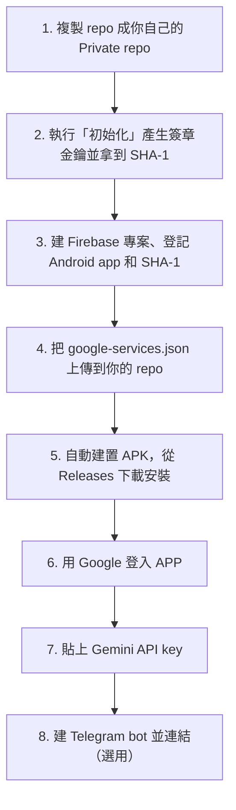

# 建置與串接教學

照順序做就能完成，不需要寫程式，也不用裝 Android Studio。APK 由 GitHub 幫你在雲端建置。總共大約 30–45 分鐘。

## 你需要準備

- GitHub 帳號（免費）
- Google 帳號：用來開 Firebase、申請 Gemini key，也是 APP 的登入帳號（三個用同一個最簡單）
- Telegram 帳號（想用 bot 才需要）
- Android 10 以上的手機

全部都用免費方案，不需要綁信用卡。

---

## 1. 複製成你自己的 Private repo

1. 在這個 repo 頁面右上角按綠色的 **Use this template → Create a new repository**。
2. Repository name 隨意取，例如 `my-life-manager`。
3. **一定要選 Private。** 下一步會把你的簽章金鑰存在 repo 裡，選公開的話任何人都看得到。
4. 按 **Create repository**。

> 不要用 Fork。公開 repo 的 fork 不能改成 Private。

## 2. 產生簽章金鑰並拿到 SHA-1

APP 要用固定的金鑰簽章，Google 登入才會認得它。

1. 進到你剛建好的 repo，點上方的 **Actions**。如果出現提示，按 **I understand my workflows, go ahead and enable them**。
2. 左側點 **1. 初始化（產生簽章金鑰）** → 右邊點 **Run workflow** → 再按一次綠色的 **Run workflow**。
3. 等大約 1 分鐘，出現綠色勾勾後點進去，頁面下方的 **Summary** 會顯示：
   - SHA-1：`AA:BB:...`
   - SHA-256：`CC:DD:...`

   先把這兩串複製到記事本。

> 這個流程只需要跑一次。之後再跑也不會重新產生金鑰，只會再顯示一次指紋。
> 左側的「2. 建置 APK」可能已經自動跑過一次並出現黃色警告，這是正常的，因為還沒做第 4 步。

## 3. 建立 Firebase 專案

1. 打開 <https://console.firebase.google.com>，按 **建立專案**，名稱隨意取。Google Analytics 可以關掉。
2. **開啟 Google 登入**：左側選單 **建構 → Authentication** → **開始使用** → **登入方式** 分頁 → 選 **Google** → 開啟 → 選一個支援電子郵件 → **儲存**。
3. **建立資料庫**：左側 **建構 → Firestore Database** → **建立資料庫** → 位置選 `asia-east1（台灣）` → 選 **以正式版模式啟動** → **建立**。
4. **貼上安全規則**：在 Firestore 的 **規則** 分頁，把內容全部刪掉，換成這個 repo 裡 [`firestore.rules`](firestore.rules) 的內容 → **發布**。這樣每個人只能讀寫自己的資料。
5. **登記 Android app**：回到專案首頁，按 Android 圖示（新增應用程式）：
   - Android 套件名稱：`com.shishonomisaki.lifemanager`（照抄，不要改）
   - 應用程式暱稱：隨意
   - 偵錯簽署憑證 SHA-1：貼上第 2 步拿到的 **SHA-1**
   - 按 **註冊應用程式**，接著出現的下載步驟先略過，一路按下一步直到完成。
6. **補上 SHA-256**：左上角齒輪 → **專案設定** → 往下捲到「你的應用程式」→ **新增指紋** → 貼上 **SHA-256** → 儲存。
7. **下載設定檔**：在同一個頁面按 **google-services.json** 下載。
   > 一定要在加好指紋**之後**才下載。如果先下載了，再下載一次新的。

## 4. 把 google-services.json 放進你的 repo

1. 在你的 GitHub repo 依序點進資料夾 `android` → `app`。
2. 按 **Add file → Upload files**，把剛下載的 `google-services.json` 拖進去。檔名必須是 `google-services.json`，如果瀏覽器自動改成 `google-services (1).json`，請先改回來。
3. 按 **Commit changes**。

> 這個檔案裡沒有密碼，但會指向你的資料庫，所以只放在你的 Private repo 就好。

## 5. 建置並安裝 APK

1. 上傳完成後，GitHub 會自動開始建置。到 **Actions → 2. 建置 APK** 可以看進度，大約 5–10 分鐘。
2. 出現綠色勾勾後，到 repo 首頁右側的 **Releases**，最新一版裡有 `life-manager-編號.apk`。
3. **用手機**登入 GitHub、打開這個頁面，點 `.apk` 下載。手機如果問「是否允許安裝不明來源的應用程式」，請允許瀏覽器安裝。
4. 安裝完成後，打開「生活管理」。

> 之後每次 repo 有變更，都會自動建一版新的。覆蓋安裝時資料不會遺失。

## 6. 登入 APP

1. 按 **使用 Google 帳號登入**，選你的 Google 帳號。
2. 照畫面設定通知、準時提醒和省電白名單。這幾項沒設好，提醒可能不會響。很多手機（例如 ASUS、小米、OPPO）的省電管理比較嚴格。

## 7. 設定 Gemini（AI 整理）

1. 打開 <https://aistudio.google.com/apikey>，用 Google 帳號登入 → **Create API key**，選你剛建的 Firebase 專案或新建一個 → 複製金鑰。
2. APP → **設定 → 自動整理（Gemini 免費額度）** → 貼到 **Gemini API 金鑰** → **儲存**。
3. 在首頁輸入「明天早上 9 點繳電話費」試試看，應該會自動抓到時間和主題。

> 金鑰加密存在你的手機裡，不會進 repo，也不會上傳到 Firebase。設定頁可以看到今天用了幾次。

## 8. 設定 Telegram bot（選用）

1. 在 Telegram 搜尋 **@BotFather** → 傳 `/newbot` → 依指示取名。帳號名稱必須用 `bot` 結尾，例如 `my_inbox_bot`。
2. BotFather 會回一串 **token**（像 `123456:ABC-...`），把它複製下來。**不要給任何人。**
3. APP → **設定 → Telegram 收件匣** → 貼到 **Bot 金鑰** → **儲存**。
4. 按 **連結 Telegram**，會跳到你的 bot，按 **開始（Start）**，再回到 APP，狀態會變成「已連結 ✅」。
5. 傳一句「後天下午兩點開會」給 bot 試試看。

> bot 只會回應已連結的那個對話，別人傳給它的訊息都不理會。想要回覆更即時，可以在設定裡打開「持續連線」（比較耗電）。

---

## 疑難排解

| 狀況 | 解法 |
|---|---|
| Google 登入失敗，或出現錯誤碼 10 | 檢查 SHA-1 和 SHA-256 是否都加進 Firebase、套件名稱是否完全一致，然後**重新下載** google-services.json，重做第 4 步 |
| 建置時出現「google-services.json 不存在」警告 | 檔案沒放進 `android/app/`，或檔名不對 |
| 建置時出現「還沒有簽章金鑰」警告 | 先執行第 2 步的「1. 初始化」，再到「2. 建置 APK」按 Run workflow |
| 初始化失敗：「這個 repo 是公開的」 | repo 要改成 Private：Settings → 最下方 Danger Zone → Change visibility |
| 提醒沒響 | 設定 →「讓提醒準時響」裡每一項都要開啟，並把 APP 加入電池最佳化白名單 |
| AI 沒在整理 | 金鑰貼錯，或今天的額度用完了（AI Studio 可以查用量）。用完時 APP 會改用規則版 |
| bot 不回應 | APP 在背景時最多要等 15 分鐘；設定裡可以按「立即收訊息」，或打開「持續連線」 |

## 之後怎麼更新

用 template 建立的 repo 不會自動同步原始版本。如果原版有更新，可以把新版的檔案複製到你的 repo，**但不要覆蓋** `android/app/google-services.json`、`android/app/release.jks`、`android/app/keystore.properties` 這三個檔。也可以請你的 AI 助手幫你同步，記得先讓它讀 [AGENTS.md](AGENTS.md)。

## 想改套件名稱（進階，可略過）

在 `android/gradle.properties` 加一行 `lifemanager.applicationId=你的.套件.名稱`，第 3 步登記 Firebase 時改用這個名稱。這樣同一支手機就能和別人的版本同時安裝。
